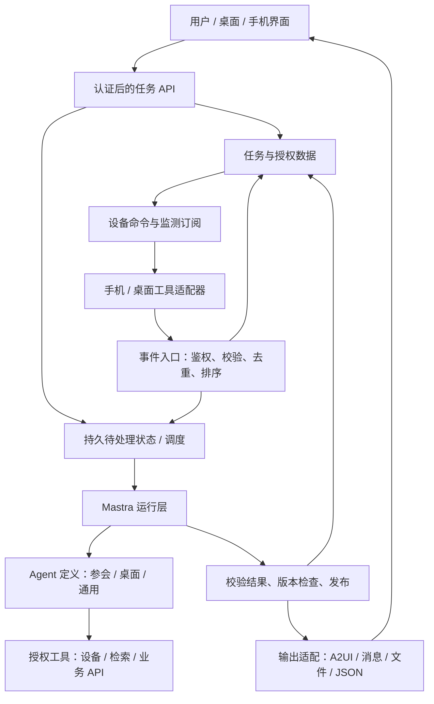

# XAgent：基于 Mastra 的专用 Agent 服务方案

日期：2026-10-22。状态：架构提案 + 小范围可运行验证；不代表已具备生产平台能力。

当前工作聚焦服务端能力，客户端渲染类型由具体产品决定。保留现有发布前的 A2UI Schema 强制校验，将其视为当前实验的服务端输出检查；不开展客户端渲染开发，也不据此限定所有未来 Agent 的输出方式。

## 1. 我们要解决什么问题

团队能够复用一套服务，开发参会、桌面、信息整理等专用 Agent。用户创建的是具体任务，例如“持续跟进下周的预算会”；任务接收设备事件、用户要求或定时触发，调用工具，形成结果，并持续更新。今天用 A2UI 展示，明天可以输出消息、文件或业务 API。

**一个 Agent 定义服务多个用户和多个任务；一个持续任务可以产生多次短暂运行。** 用户和任务增加主要增加数据与活跃运行量，不要求复制 Agent 代码或常驻一个模型进程。

“每个功能创建一个 Agent”适用于有独立职责、提示词、工具集和评测标准的能力。一个小步骤通常用工具或 Workflow 即可。参会 Agent 和桌面 Agent 可以分别定义；每一场会议、每一个用户不另建定义。

## 2. 推荐架构

先在现有服务器单体部署，保留模块边界。当前用 SQLite + LibSQL 存储、进程内有限并发调度；出现多副本、较大并发、跨服务交付要求时，再迁移到 PostgreSQL、持久队列和独立 Worker。现在不先搭建微服务、Redis、Kubernetes 或通用低代码平台。

## 3. Mastra 与业务服务各自负责什么

| 能力 | 采用方式 | 团队还需要负责 |
|---|---|---|
| Agent 定义、模型调用、工具循环 | Mastra Agent / Tool | 职责、提示词、工具契约、质量评估 |
| 固定步骤与分支 | 需要时使用 Mastra Workflow | 业务条件、重试与补偿策略 |
| 等待一次设备结果或用户确认 | 已验证 Mastra suspend/resume + 持久存储 | 回调鉴权、超时、取消、结果账本 |
| 记忆与上下文 | 按需使用 Mastra Memory / RequestContext | 任务作用域、用户授权、数据保留 |
| 持续任务、订阅与事件交付 | 薄业务层；后续可评估 Harness signals/schedules | 设备绑定、事件幂等、生命周期、版本与结果一致性 |
| 多用户、多组织 | 业务身份与授权层 | 登录、成员关系、配额、工具凭据与数据隔离 |
| 页面和内容输出 | 业务结果 Schema + 可替换适配器 | A2UI catalog、渲染器、客户端重连与版本控制 |
| 可观测性 | Mastra 能力结合业务日志 | task/run/event 关联、费用和质量指标、告警 |

Mastra 能降低运行 Agent 的开发量，但不会自动把任意工具变成安全的多用户服务。此次先复用现有运行层，不同时引入 Harness；真实需求出现后再比较它与薄任务层的成本。

## 4. 核心对象与隔离规则

| 对象 | 含义 | 生命周期 |
|---|---|---|
| AgentDefinition | 代码、提示词、工具与输出契约；有版本 | 团队发布 |
| User / Tenant | 已认证用户与组织 | 账号 / 成员关系 |
| Task | 用户委托的长期目标、配置、当前事实、结果版本 | 用户创建至停止 / 删除 |
| Subscription | 特定设备、事件类型、过滤条件与任务绑定 | 安装、确认、有效、失联、撤销 |
| Event | 设备或外部系统的一次观察 | 先落库再确认接收 |
| Run | 一次触发产生的模型执行 | 排队、执行、等待、成功 / 失败 / 取消 |
| Artifact / View | 被发布的业务结果和展示数据 | 随任务版本更新 |

身份由认证中间件产生，模型和请求正文不能指定或覆盖 owner。工具从服务端 RequestContext 获取 task/run/owner，再检查资源归属。即使模型在工具参数中写了别人的 taskId，也不能扩大访问范围。

Memory 的 `resourceId`、`threadId` 是上下文组织方式，不能代替认证。若启用 Memory，默认以租户 + 用户 + 任务划定资源与线程；只有明确授权的用户偏好才跨任务共享。不得让默认用户级 working memory 意外共享会议敏感内容。本次用显式任务事实，不启用隐式长期记忆。

## 5. 两种等待，使用不同机制

**一次调用：** 云端请求拍照 → 保存 callId → Mastra 挂起 → 手机结果落库 → 恢复原运行。已有实验覆盖重启恢复、重复回调、超时、取消。

**持续监测：** 云端安装日历监测订阅 → 手机确认安装 → 本次请求结束。以后每个日历变化独立上报，触发新的 Agent run。闲置任务只占存储，不保持模型会话或等待中的 HTTP 请求。

订阅 ACK 只表示适配器接收并安装了监测，不证明手机永远在线。正式端侧需要权限、系统后台限制、心跳或租约、断线补报、取消确认与重新安装机制。云端设计不能绕过手机操作系统的限制。

## 6. 事件、并发和刷新

1. 事件入口根据设备凭据找到订阅和任务，验证类型、结构、序号。
2. 同一任务内 eventId 唯一；相同重试返回 duplicate，不产生新的运行。相同 ID 不同内容冲突；旧序号拒绝，防止旧事实覆盖新事实。
3. 事实、事件与任务输入 revision 在同一事务落库，然后确认接收。调度扫描持久状态，重启后仍能发现待处理任务。
4. 每个任务串行处理，可以合并频繁事件，只生成最新视图；全局与每用户限制并发。所有事件仍留在账本。
5. 模型读取某个 revision 的快照，工具检索只访问该任务获授权的资料。
6. 输出经过 Schema 校验和来源检查；提交时再次比较 revision。过期结果丢弃，继续处理新版本，防止慢运行覆盖新内容。
7. 页面用稳定 surfaceId；客户端按 publishedRevision 接受新结果。初次发送 createSurface，后续更新组件和数据。重连请求完整快照。上线实时推送时再加 SSE / WebSocket。

允许只读推理在重启后重新执行，**不承诺模型只调用一次**。付款、发信等外部写操作需要独立幂等键、授权与执行账本，不能套用重跑推理策略。实验的结果提交是本地受控写入。

## 7. 新增一个专用 Agent 的开发方式

业务团队通常新增：职责与提示词、业务配置 / 输出 Schema、专属工具、代表性样例与评测、可选展示适配器。复用：任务身份、订阅、事件、调度、模型连接、设备协议、结果版本、运行日志。

第一版保留 TypeScript 代码注册，避免提前建设动态插件市场。当前已将参会与信息巡检拆成两种 AgentDefinition，通过一处 registry 注册，公共任务层统一运行；详见 [第二种 Agent 验证](second-agent-validation.md)。这验证了两种只读事件任务的复用，不宣称所有领域都能无改动接入。

| 变化 | 主要维护范围 |
|---|---|
| 用户增加 | 数据、设备凭据、活跃量和配额；不复制提示词 |
| 同类任务增加 | 独立配置、事实与产物；共用定义 |
| 新 Agent 类型 | 新职责、专属工具与评测；复用公共服务 |
| 新手机系统 | 端侧适配与权限 / 后台策略 |
| 新展示方式 | 输出适配器与客户端 |
| 模型升级 | 契约兼容、质量与成本回归，定义版本灰度 |

团队协作边界可以是：运行与任务公共能力、设备适配、业务 Agent、客户端展示。小团队可以合并负责人，但接口和测试责任保留。

## 8. 首个验证：参会准备助手

选择理由：自然包含持续事件、用户调整、资料检索和结构化输出；同时可以限制成一个小闭环，而不先做录音、转写、完整日历 App。

范围：两名测试用户各两个独立会议任务，共用一个 meeting-prep Agent 定义。模拟设备接收 watchCalendar 命令并 ACK，之后上报会议主题 / 议程变化；Agent 调用任务内资料检索工具，提交简报和准备清单；用户修改关注点后再生成；适配器输出 A2UI v0.9.1 JSON。使用服务器已配置的 DeepSeek 作真实模型验证。

验收与限制见 [meeting-validation.md](meeting-validation.md)。完成这个验证后，再根据代码增量、运行次数、耗时、恢复行为和第二个领域的接入成本，判断是否继续沿用 Mastra。一个样例通过不能证明任意 Agent 都低成本。

当前结果：参会闭环已经在 tencent-server 用真实 DeepSeek 通过，四个独立任务共七次模型运行；用户调整、设备事件、重复 / 乱序处理、重启恢复和 A2UI Schema 校验均得到覆盖。建议继续沿用当前单体方案，下一阶段聚焦服务端任务生命周期、工具失败与执行恢复、并发和运行成本，以及第二种 Agent 的复用验证，暂不扩建平台基础设施。

后续进展：第二种 `information-watch` 已完成，共用 `src/tasks/*` 的存储、事件、API、调度、模型与发布校验。两用户各运行两种 Agent，最终一轮九次真实模型运行、八组检查通过，本地测试增至 24 项。原有会议结果与接口保留；后续聚焦服务端故障与并发验证。

第三种 `travel-assistant` 已接入[原生浏览器工具](travel-assistant.md)，支持用户请求型任务直接执行。公共定义增加可选 initialEvent、运行预算与结束清理钩子，原设备事件型任务保持兼容。实际通过 DeepSeek + Chromium 生成延吉三日计划及来源图片，继续保留 A2UI 发布前强制校验；没有客户端渲染开发。

## 9. 生产化分阶段

- 当前：可解释的单机闭环和自动验收，保持现有设备调用实验。
- 服务端可靠性与复用：通过模拟工具和脚本验证运行中断、工具失败、任务生命周期与并发限制；接入第二种 Agent 评估新增开发与维护成本。
- 真实端侧试点：待具体需求确定后接入一个真实事件源；端侧后台存活另行验证。
- 团队开发底座：已提取两种 Agent 的共用接口；后续增加 OIDC、组织权限、凭据库、预算与运行可观测性。
- 规模化：按实测瓶颈引入数据库 / 队列 / 多 Worker；多租户隔离、外部写操作审计和故障演练。

服务端待明确的问题：部署租户模型、实时性与漏报容忍度、数据保留要求、预期活跃任务量、模型与工具预算。手机权限和客户端渲染方式留给具体产品对接，不阻塞当前服务端验证。

## 10. 参考与版本

本地依赖锁定 Mastra Core 1.78.0 / LibSQL 1.26.2；在线文档可能领先于锁定版本，具体实现以本地类型与测试为准。

- [Mastra Agent](https://mastra.ai/docs/agents/overview)、[工具与暂停恢复](https://mastra.ai/docs/agents/human-in-the-loop)
- [RequestContext](https://mastra.ai/docs/server/request-context)、[Memory](https://mastra.ai/docs/memory/overview)
- [结构化输出](https://mastra.ai/docs/agents/structured-output)、[Harness](https://mastra.ai/docs/harness/overview)
- [A2UI v0.9.1 协议](https://github.com/a2ui-project/a2ui/tree/main/specification/v0_9_1)
