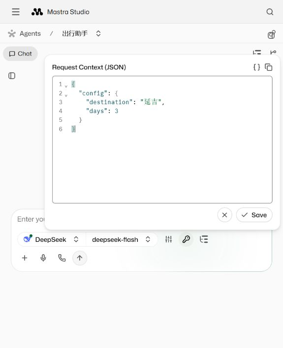
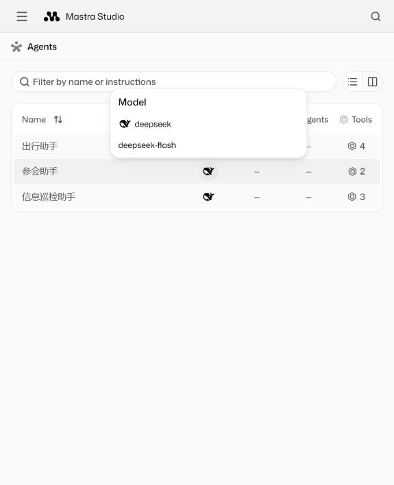
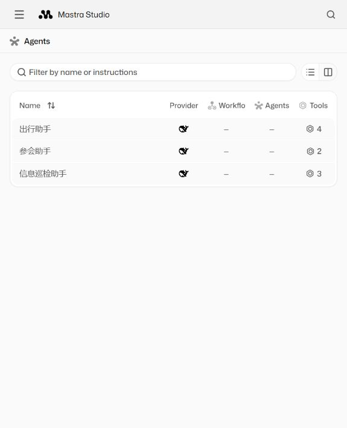
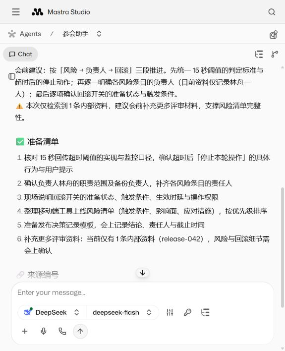
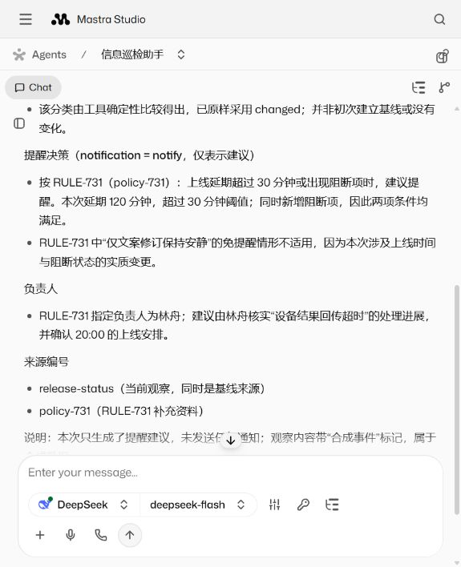
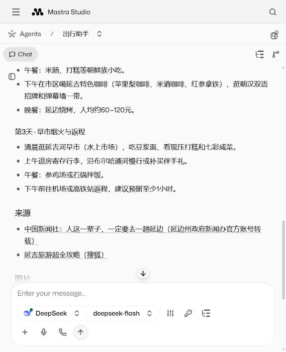

# Studio 默认真实模型验收

2026-10-23，源码提交 `c26552c94a14f98742c9312f9adea305bb5107d8`，服务器 release `c26552c94a14-20261023T034730`，运行输入摘要 `0ee46044c1ee76f29dda84cba82748da1f2e6c8093641513f5d011af98df8699`。

## 当前行为

Studio 入口默认 `deepseek`，可通过服务端 `XAGENT_DEFAULT_MODE` 覆盖。三个 Agent 的模型解析与输入 Schema 共用 `src/agents/model.ts`；请求显式 `mode` 优先，省略则采用服务默认值。模型元数据查询不调用模型 API，缺 key 的真实模式明确失败。持久任务仍显式传入自身保存的模式；独立任务服务入口未设置默认 DeepSeek。原 4391 服务未重启或升级。

已有浏览器上下文若保存 `mode: mock`，它仍有优先级；删除该字段并 Save 即可采用服务默认值。新增三个「服务默认模型」预设，原显式 mock / deepseek 预设继续保留。目的地、会议、观察等业务参数仍需提供。

## 验证结果

| 入口 | 结果与证据 |
| --- | --- |
| 本地构建和回归 | 在 `XAGENT_DEFAULT_MODE=deepseek` 下完整运行，53 项 TypeScript + 10 项 Python 测试通过；[本地报告](default-mode-local.json)。新增检查默认模型元数据不联网、显式 mock 工具离线执行、缺 key 不回退、无效模式拒绝和显式覆盖。 |
| Studio 发布 | 受管发布成功，状态 `defaultMode=deepseek`；部署 mock smoke 通过，一致性备份保留在服务器 `backups/20261023T034946228623.sqlite`。列表三个 Agent 均返回 `provider=deepseek` / `modelId=deepseek-flash`。 |
| 隔离任务 API | 4491 隔离服务中 3 次真实 DeepSeek 运行：参会、巡检初次基线、巡检事件变更，全部通过。任务结束后暂停，临时容器移除，原任务数据摘要不变；[任务报告](default-mode-task-api.json)。 |
| Studio 页面 | 实际编辑、Save 并发送三个助手的请求，全部省略 `mode`。均返回真实 DeepSeek 元数据、提交工具 `accepted: true`、artifact 和中文最终回复；[页面报告](default-mode-ui.json)。 |

页面验收均新建会话，标记 `DEFAULT-MODE-20261023`。从工具详情检查通过校验的 A2UI 消息，服务器 Memory 再核对结果；报告仅提取模型标识、工具结果、artifact 和文本回复，不保存私有推理。

- [参会会话](http://127.0.0.1:4411/agents/meeting-prep/threads/19a67cb1-055b-48d9-ac85-b8ab0895bb93)：资料 `release-042`，简报包含 15 秒阈值、负责人林舟和回滚准备。
- [巡检会话](http://127.0.0.1:4411/agents/information-watch/threads/d96c85b8-ab08-45bb-93c0-5a217123acaf)：`changed / notify`，引用观察与 `policy-731`，只生成建议。
- [出行会话](http://127.0.0.1:4411/agents/travel-assistant/threads/94ad54e9-c94b-4cb1-bd04-df2e902f477b)：3 次浏览器搜索、2 次页面读取、1 次图片整理、1 次提交；返回延吉 3 天行程、2 个来源页面、1 张网页加载图片的元数据和链接。

出行会话刷新后历史、模型和不含 `mode` 的已保存上下文仍存在。发布前已有的 12 条 Studio 消息内容摘要全部保持一致，原任务数据摘要保持一致。临时任务验收服务已清理。

验证记录整理时，首次只接受 `role=user` 的检查失败；实际 Studio `sendMessage` 将用户唤醒输入保存为 `role=signal`，与当前调用边界一致。检查已按该实际格式同时接受 user / signal，并仍强制核对用户输入标记、两条消息、模型元数据、工具提交和最终回复；没有为此重发模型请求。

会议和巡检的事件、资料是合成输入，没有接入真实手机、日历或通知服务。出行使用真实 AgentBrowser / Chromium，但本轮搜索没有返回可用 gov.cn 页面，最终使用腾讯新闻与搜狐页面；回复明确说明来源局限。图片未做目视或版权核验。Memory 未提供这些 UI 运行的 token 用量，因此不推算用量；没有执行长期负载测试。

