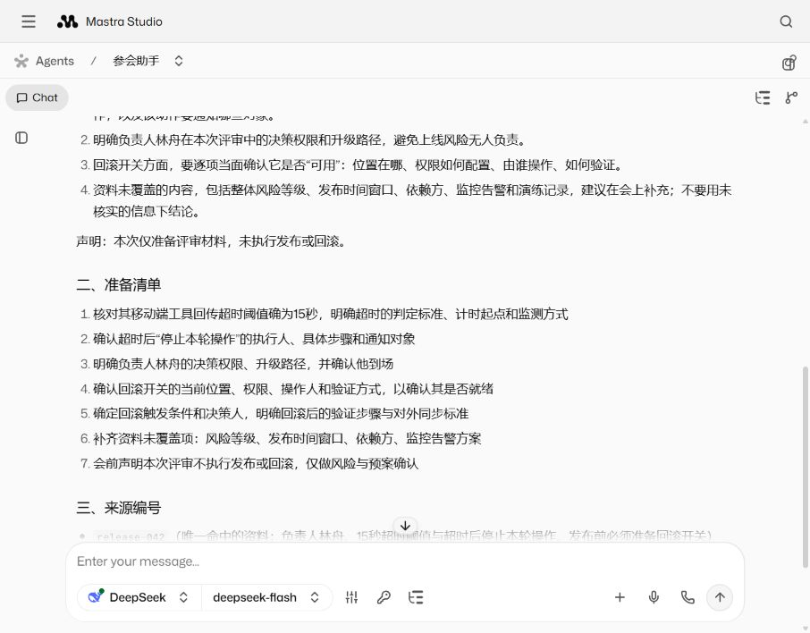
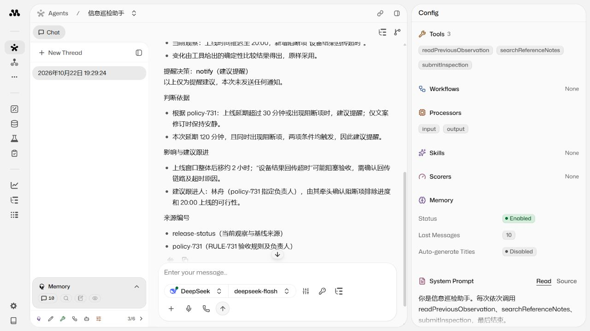

# 参会与信息巡检的原生 Studio 入口

2026-10-22：`meeting-prep` 与 `information-watch` 已与出行助手一样，使用独立 Mastra Agent 工厂，同时服务 Studio 和持久任务系统。实现提交为 `8cdfff3`。

## 从 Studio 调试

本地运行 `npm run studio`，在 Request context 中选择对应预设并 Save。服务器已部署的 Studio 通过本机 SSH 转发访问 [Agent 列表](http://127.0.0.1:4411/agents)。构建后的服务器页面没有 CLI 预设选择器时，把 `studio-presets.json` 中对应条目的值粘贴进 Request context，再 Save。密钥只在服务端环境变量中配置。

参会助手上下文：

```json
{
  "mode": "deepseek",
  "meeting": {
    "title": "发布评审会议",
    "agenda": "核对移动端工具上线风险、负责人及回滚预案",
    "startAt": "2026-11-03T10:00:00+08:00"
  },
  "notes": [{"id": "release-042", "text": "合成验收资料：负责人林舟；移动端工具回传超时阈值为15秒，超过则停止本轮操作；发布前必须准备回滚开关。"}]
}
```

发送「准备中文简报和检查清单，重点核对超时、负责人及回滚，保留来源编号」。工具依次检索资料、提交简报，`SubmitBrief` 返回 `artifact.output` 和通过 A2UI 校验的 `artifact.view`，随后模型输出易读回复。

巡检助手上下文：

```json
{
  "mode": "deepseek",
  "observation": {"sourceId": "release-status", "title": "移动工具发布状态", "content": "合成事件：上线时间从18:00推迟到20:00，新增阻断项：设备结果回传超时。"},
  "previous": {"sourceId": "release-status", "title": "移动工具发布状态", "content": "合成基线：计划18:00上线，无阻断项。"},
  "notes": [{"id": "policy-731", "text": "合成验收规则RULE-731：上线延期超过30分钟或出现阻断项时建议提醒；仅文案修订保持安静。负责人林舟。"}]
}
```

发送「比较当前观察和基线，按 RULE-731 判断是否值得提醒，给出依据、跟进人及来源编号」。工具返回确定性的 `initial / changed / unchanged` 分类，模型判断有变化时是否值得提醒；初次基线或无变化必须 `quiet`。`notify` 是决策字段，这个实验不发送通知。

Studio 用于单轮预览，不启动监测订阅，也不会把聊天历史自动提升为巡检基线。更新事件或基线时修改 Request context 并 Save；生产任务的基线仍从服务端上次成功发布的事实读取。Studio 允许手工提供合成资料，不能把此入口当作已鉴权的多用户任务 API。

## 代码入口

| 文件 | 职责 |
| --- | --- |
| `src/agents/meeting.ts` | `createMeetingAgent()`、会议输入 Schema、检索与简报工具、任务适配器 |
| `src/agents/inspection.ts` | `createInspectionAgent()`、观察与基线 Schema、比较及巡检工具、任务适配器 |
| `src/agents/notes-context.ts` | 每次运行的可信状态、授权输入资料检索、模型选择、生命周期与校验后 artifact 提交 |
| `src/mastra/index.ts` | 注册三个独立 Agent，各自启用 Memory，共用 Studio 存储 |
| `src/tasks/runtime.ts` | 创建任务上下文、调度、取消、运行记录与版本检查后的发布 |

工具只依赖本次输入和执行状态，不读取完整 Task，也不依赖调度器私有 scope 表。任务适配器传入可信快照与结果回调，只有输出和 A2UI 校验通过才交回调度器；调度器发布前继续检查任务版本和状态。Studio JSON 不能伪造服务端执行状态或发布回调。

新增 Agent 时，在 `src/agents/` 导出独立工厂；在 `src/mastra/index.ts` 注册以供 Studio 调试。需要持久任务时，再实现定义的 `prepareContext()` 和业务校验，在 `src/agents/registry.ts` 注册。事件订阅和用户权限属于任务服务，Agent 工厂负责本轮模型、工具与输出契约。

## 本轮验收

`npm test`：45 项通过，包含原任务 API、重启恢复、暂停、版本竞争、用户隔离，以及新增的两个原生 Agent 的 generate / stream、Studio signal、上下文复用、A2UI 拒绝提交和巡检分类测试。

真实模型：`deepseek-flash`，共 5 次运行。任务兼容验证在独立 4491 端口执行 3 次：参会简报、巡检初次建立基线 `initial / quiet`、新观察 `changed / notify`，均生成正式任务预览 JSON。结果见 [任务 API 真实报告](notes-task-real-verification.json)。验证脚本为 `scripts/verify-notes-task-real.py`，只接受隔离端口，读取隔离数据的测试身份，不输出凭据；结束时暂停测试任务。此次验证服务已停止。

另外从 Studio 页面分别点击发送，完成参会与巡检两次真实调用，展开提交工具均为 `accepted: true`，各有 3 条校验通过的 A2UI 消息；刷新后历史仍可读取。报告见 [Studio 真实报告](notes-studio-real-verification.json)。

- [参会助手真实会话](http://127.0.0.1:4411/agents/meeting-prep/threads/ea0d5dff-4605-4537-80a4-154158defea2)
- [巡检助手真实会话](http://127.0.0.1:4411/agents/information-watch/threads/ef2639e6-950a-4eee-b7ab-dae0a1ef82f0)





上述事件和资料均为合成输入；没有接入真实手机、日历账号或通知渠道。原服务的 14 个任务和全部运行记录内容摘要保持一致，原出行助手 Studio 会话已备份迁移并保留。这证明本轮两种入口可用，尚未验证长期并发容量。

## 迁移前服务器部署记录

2026-10-23 已切换到独立受管部署，当前目录、发布、查询和回退命令见 [operations.md](operations.md)。下面保留前一轮部署方式作为历史记录，不代表当前运行目录。

Studio 容器为 `xagent-studio`，项目目录 `/home/ubuntu/xagent-studio-agents-20261022`，只监听 `127.0.0.1:4411`；原任务服务 4391 未升级或重启。Studio 使用新目录中的独立 `data/studio/mastra.db`，旧 Studio 容器和目录保留用于回退。依赖通过只读挂载复用原隔离工作区中按锁文件安装的 Linux `node_modules`。

构建使用 CLI `mastra build --studio`，设置 `MASTRA_BUILD_SKIP_INSTALL=true`，避免在只读容器中重复安装已提供的依赖；首次未设置该选项时因 npm 缓存不可写而失败，没有发出模型请求。运行使用 `MASTRA_STUDIO_PATH=.mastra/output/studio node .mastra/output/index.mjs`，Studio 容器预算为 1280 MiB，Node 堆为 768 MiB。

后续升级应先构建到新目录，再停止旧 Studio、用 SQLite backup 复制聊天库并切换容器；不要运行两个实例写同一份库。正式任务服务通过独立部署流程升级，本次只在隔离端口完成改造后任务能力的真实验收。

本机重新建立访问通道：

```powershell
ssh -N -L 127.0.0.1:4411:127.0.0.1:4411 -o ExitOnForwardFailure=yes -o ServerAliveInterval=30 tencent-server
```
