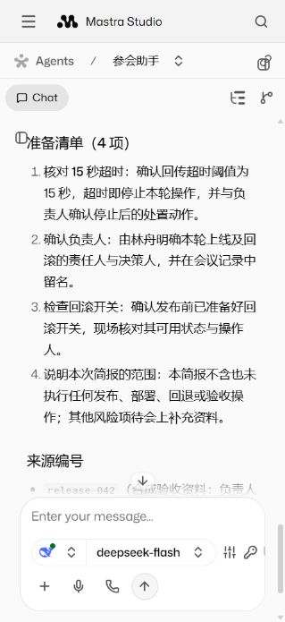
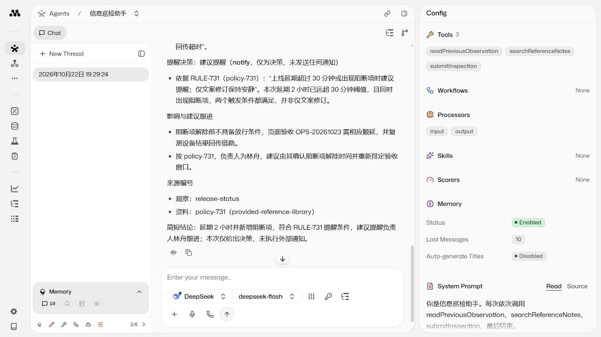
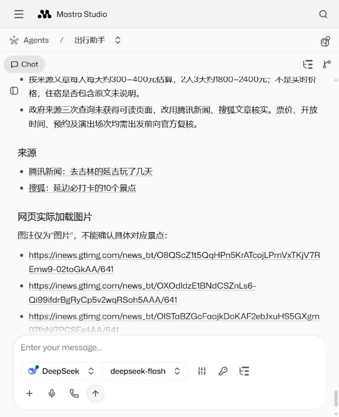

# 统一验证与 Studio 发布验收

2026-10-23，tencent-server。当前运行构建提交 `a45533207a79e6bcfed71a2a8cb0a918ddf6c996`，release `a45533207a79-20261023T023255`。后续仅报告/文档提交不改变运行摘要，以 `npm run studio:status` 和实际状态接口核对部署版本。

## 结果

| 验证 | 结果与证据 |
| --- | --- |
| 本地构建及回归 | 49 项 TypeScript、10 项 Python 运维测试通过，共 59 项 |
| 统一入口全流程 | `npm run check -- --suite all --mode mock` 返回成功；包含本地回归、3 个 Agent API 和隔离任务 API；[报告](operations-all-mock.json) |
| 首轮真实服务器 API | 构建 `b06ab3d` 的三个 Agent API 和三次任务运行共 6 轮成功；当时 Windows 客户端汇总因编码失败，不能算整个 CLI 成功；[原始服务器证据及失败说明](operations-real-api-baseline.json) |
| 修复后真实入口 | 构建 `a455332` 通过统一入口再运行一轮参会助手真实调用，返回成功并保存中文报告；[报告](operations-real-entry.json) |
| Studio 真实页面 | 当前构建分别从三个页面输入并发送，检查提交工具 `accepted: true`、artifact 与最终中文回复；[页面验收报告](operations-ui-validation.json) |
| 发布与回退 | 3 次发布（含首次旧实例接管）、2 次版本回退/切回均通过 readiness、版本检查及 mock smoke；[操作记录](operations-validation.json) |
| 数据与清理 | 迁移前的 6 条聊天消息内容未变化，SQLite integrity_check 为 ok；每次操作的原任务库内容摘要保持一致；临时任务容器和浏览器进程已释放 |

本次共 10 轮真实 Agent 运行：首轮服务器 6 轮、修复后入口 1 轮、页面 3 轮。每轮包含多步模型与工具调用，不等同于 10 个模型 HTTP 请求。供应商/模型为 DeepSeek `deepseek-flash`，会议资料及设备观察均为合成输入，没有真实手机接入或外发通知。`b06ab3d` 到 `a455332` 的业务 Agent 代码未改变，修复的是客户端编码及其测试。

## 发现和处理

- 初次运维测试发现 Python SQLite 连接的事务上下文不会自动关闭连接，导致 Windows 清理文件失败；改为显式关闭，并验证活跃 WAL 内容能完整备份。
- Git 归档受 Windows 换行转换影响，导致与 Git blob 的运行摘要不一致；归档固定 `core.autocrlf=false`，测试覆盖 Git 归档一致、普通文档更新不改变摘要、运行源码修改必须改变摘要。
- 首轮真实调用服务器端已成功，客户端用默认 GBK 读取中文 UTF-8 报告失败。显式 UTF-8 读写和子进程解码后，用全 mock 流程及一轮有限真实调用验证，不盲目重复六轮付费场景。
- 多个 Studio 聊天页同时打开时，巡检请求曾停留等待且未形成新的持久记录。已完成页面返回 Agent 列表、单独重试后完成；未确定网络层根因，不声称已修复 Studio 并发标签问题。页面验收建议串行进行，先确认新运行、最终回复和持久记录，再标记通过。

## 页面证据

在已有会话追加验收请求，保留原历史：

- [参会会话](http://127.0.0.1:4411/agents/meeting-prep/threads/ea0d5dff-4605-4537-80a4-154158defea2)：核对 15 秒阈值、负责人及回滚开关，生成四项准备清单。
- [巡检会话](http://127.0.0.1:4411/agents/information-watch/threads/ef2639e6-950a-4eee-b7ab-dae0a1ef82f0)：`changed / notify`，保留规则和来源，明确未发送通知。
- [出行会话](http://127.0.0.1:4411/agents/travel-assistant/threads/02ba92f2-2061-4308-b3ec-1f0c16759c8d)：真实搜索、读取来源、整理加载图片、提交三日计划。来源质量和信息时效仍需业务核实。

页面报告中的模型元数据、工具结果与截图共同支持实际浏览器步骤；数据库记录本身不能替代界面验收。CLI 报告继续保持 `uiVerified: false`，独立页面报告才标记本次实际 UI 验收。

## 保留与限制

当前受管 Studio 位于 `/home/ubuntu/xagent-studio`，4411 仅回环开放；原任务服务 4391 未升级或重启。新镜像自带依赖，运行时仅挂载独立数据和只读控制目录，未挂载旧 `node_modules`。旧容器、备份及构建保留用于恢复，没有自动清理历史镜像。

回退演练在无业务运行时完成；排空拒绝新运行、已有运行计数及超时不切换由自动测试覆盖，没有主动打断用户的真实请求验证强制恢复。未验证长期并发容量、跨版本不兼容数据库迁移或公网多用户认证。首次旧实例接管仍是显式维护切换，不具有新版本的自动排空保证。

命令和前置条件见 [operations.md](operations.md)。本地访问需保持 SSH 转发；工具创建的临时转发不作为常驻服务保证。
