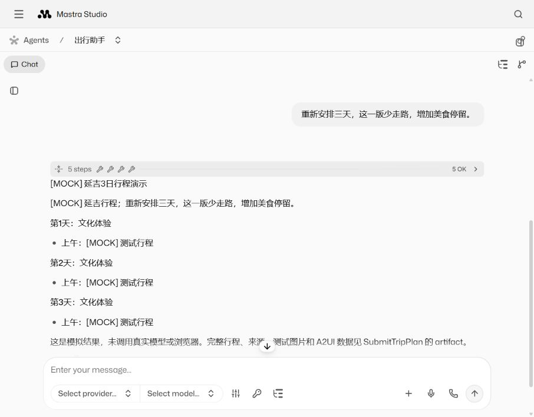
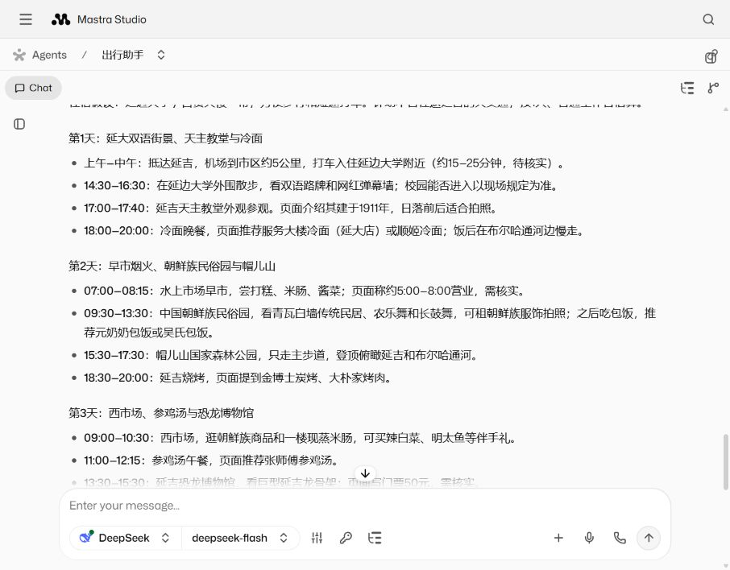

# Mastra Studio：出行、参会与信息巡检

三个 Agent 均可从 Studio 调试。参会和巡检的参数示例、代码入口及真实验收见 [参会与巡检 Studio 接入](notes-studio.md)。服务器当前界面是 http://127.0.0.1:4411（需要 SSH 转发）；下述 4111 是本地开发默认端口。

服务器现在由独立发布命令管理，使用 [统一验证和 Studio 运维入口](operations.md)；[发布、回退及最新页面验收](operations-validation.md)已经完成。下文的旧工作区和首次测试数据是对应日期的历史记录。

## 启动和查看

Studio 省略请求 `mode` 时默认使用 DeepSeek，需先在运行 Studio 的服务器配置 `DEEPSEEK_API_KEY`。服务端可用 `XAGENT_DEFAULT_MODE=mock` 启动离线调试；请求显式的 `mode` 优先于环境默认值。列表 Provider 与实际请求采用同一套默认解析，查询列表不会调用模型 API。旧浏览器中保存的显式 `mode: mock` 仍然有效，可删除该字段并 Save 以使用服务默认值。

需要 Node.js 24+。在项目根目录执行：

```powershell
npm.cmd ci --ignore-scripts --no-audit --no-fund
npm.cmd run studio
```

打开 http://127.0.0.1:4111，选择「出行助手」。点击输入框下方的 **Request context**，选择「延吉三日游（模拟，不联网）」预设，点击 **Save**，然后发送：

> 安排延吉三日游，偏重美食和步行，节奏轻松一些。

模型和浏览器动作都在 mock 模式模拟，回复及来源会标记 `[MOCK]`，图片 URL 是测试值。展开 **SubmitTripPlan** 的工具返回，可查看 `artifact.output` 中的完整行程、来源、图片，以及 `artifact.view` 中通过官方 Schema 校验的 A2UI 数据。Studio 展示的是聊天和工具 JSON，不会自动把 A2UI 数据渲染为专属行程页面。

Studio 使用 `data/studio/mastra.db` 保存调试会话，可刷新页面查看历史。它不启动任务调度器，不打开正式任务数据库，不发布或修改正式任务。仅监听本机回环地址；CLI 遥测由启动脚本关闭。

如 4111 被占用，可在 `.env` 设置 `STUDIO_PORT=4112`；也可设置独立的 `STUDIO_DATA_DIR`。`npm run dev` 仍启动原有任务服务，`npm run studio` 启动独立的 Mastra 开发服务，两者可同时运行。

## 真实模型与浏览器

本地 `.env` 需要 `DEEPSEEK_API_KEY`，并按需设置 `DEEPSEEK_MODEL` / `DEEPSEEK_BASE_URL`。密钥只从服务端环境变量读取，不填入 Studio 上下文。服务器已有的密钥不会自动出现在本机。

出行助手的真实浏览器需要可用的 Chromium，可通过 `CHROMIUM_PATH` 指定。然后选择「延吉三日游（DeepSeek + 浏览器）」预设运行；会产生实际 API 用量和网页访问。原有服务器 Docker 镜像包含 Chromium；Studio 使用独立容器和数据目录。

## 代码边界

- `src/mastra/index.ts`：标准 Mastra 入口，注册出行、参会、信息巡检三个 Agent；LibSQL 和 Memory 用于 Studio 会话。
- `src/agents/travel.ts` 的 `createTravelAgent()`：Studio 和任务系统共用的 Agent、模型选择、指令、处理器和工具。
- `src/agents/travel-context.ts`：校验配置、建立每次执行的状态、管理资源清理。内部状态是服务端类实例，不接受 JSON 冒充。
- `src/tools/browser.ts`：只依赖浏览器运行参数，不依赖任务数据库或完整 Task 对象。
- `travelDefinition.prepareContext()`：把持久任务快照转换为原生 RequestContext，把校验后的输出交还任务调度器。
- `src/tasks/runtime.ts`：继续管理调度、用户并发、取消、运行记录和版本检查后的正式发布。
- `src/tasks/view.ts` 的 `displayView()`：两种入口共享的 A2UI Schema 强制校验；任务发布前仍再次校验。

参会和信息巡检也已迁移为独立工厂，工具使用本次执行输入；`src/agents/notes-context.ts` 共用资料检索、执行状态和 artifact 提交逻辑。两者的 `prepareContext()` 把任务事实及已发布基线转换为原生输入；调度器不再向 Agent 注入私有 scope 查找函数或模型。原任务 API 的行为继续保留。

## 每次执行与历史

在 Request context 中明确指定 `config.destination` 和 `config.days`；`mode` 可省略以使用服务默认模型，对应「服务默认模型」预设。每轮使用最新用户消息作为规划要求；目的地和天数不会从自然语言自动提取。修改目的地或天数时，先修改上下文并 Save。历史对话保留用于查看，但每次规划重新收集来源，不把上一轮的工具结果当成本轮证据。

普通 SDK 调用使用新建的 RequestContext。任务系统每次都创建新的上下文。模型选择不依赖任务运行表；没有配置也可列出 Agent，真正执行时必须通过配置校验。

Studio 的线程消息入口与直接 `agent.stream()` 不完全相同：`sendMessage()` 可用用户 signal 唤醒线程。输入处理器保留原始用户消息和系统/信号消息，通过标记的系统消息传递本轮配置，不向聊天记录追加内部参数 JSON；不能假设处理器收到的一定是普通 `role:user` 消息。

成功提交工具返回完整 artifact 后，真实模型会据此回复中文摘要和链接。mock 仅用于协议与执行链路验证，不评价模型规划质量。

## 验证

```powershell
npm.cmd test
node scripts/verify-studio.mjs
```

原有任务、事件、设备暂停恢复和 A2UI 测试继续执行。新增原生 generate/stream、Studio sendMessage、上下文隔离、重复调用、异常/取消清理、无效输入及 A2UI 拒绝发布测试。模拟清理测试验证执行状态关闭、证据会话释放，不代表已经实测本机真实 Chromium 进程退出。

`verify-studio.mjs` 需要 Studio 已启动，使用标准 HTTP API 运行 mock 验收，检查结果、工具链、A2UI 数据，以及默认正式任务文件未变化，报告写入 `docs/studio-verification.json`。它不调用真实模型或浏览器。

Studio CLI / Memory 是开发依赖；现有 Docker 部署继续运行任务 API。本次没有把 Studio 暴露到公网，也没有改为生产 Studio 部署。

## 本次本地验收

2026-10-22：`npm.cmd test` 共 34 项通过，其中 8 项为本次新增的原生 Agent / Studio 入口测试。标准 HTTP 验收通过：5 次工具调用、3 天行程、2 张模拟图片、3 条 A2UI 消息，默认正式任务文件摘要未变化。结构化报告见 [studio-verification.json](studio-verification.json)。

通过实际 Studio 页面发送了两轮规划要求，均显示 5 个成功工具步骤和对应回复；展开 SubmitTripPlan 可见完整 artifact，刷新页面后历史仍保留。上述首轮是 mock 验收；随后补做的真实验证见下节。界面记录：



## 改造后的真实验证

2026-10-22 在 tencent-server 的独立验证目录、隔离数据和临时容器中，使用提交 `0524c76` 的源码和锁文件构建标准 Mastra 服务。密钥通过服务器已有的 env 文件注入临时容器，没有复制回本机或写入报告。

通过 `POST /api/agents/travel-assistant/generate` 执行一轮 `mode=deepseek`：DeepSeek `deepseek-flash` 实际调用 AgentBrowser / Chromium。共 4 次搜索、3 次页面读取、1 次图片整理、1 次计划提交；耗时 52.221 秒，得到 3 天行程、3 个来源页面、4 张网页加载图片及 3 条通过校验的 A2UI 消息。Mastra 汇总用量为 54,169 tokens。模型最终回复及原始结果见 [真实验证报告](studio-real-verification.json)、[可读行程](yanji-studio-real.md)。

3 个来源页面来自腾讯和搜狐，其中两个页面转载了同一篇文章；这证明真实调用链可运行，不代表旅行信息已由三个独立来源交叉核验。图片说明来自网页，未逐张目视核验。

请求结束后检查临时容器的 `/proc`，未发现 Chromium / agent-browser 残留进程。正式服务的 14 个任务、运行记录及数据库内容摘要与验证前一致，活跃任务和运行中记录均为 0。验证容器均已停止并移除；正式服务未更新或重启。

首次启动遇到 Studio 构建超过 Node 默认约 512 MiB 堆上限，尚未发出模型请求。随后在独立构建进程中使用 768 MiB 堆、单构建并发完成构建，再直接运行 `.mastra/output/index.mjs`，不同时保留开发构建监听器。成功的真实请求运行在 768 MiB 容器预算内；应区分开发构建开销与 Agent API 的运行开销。

真实验证脚本是 `scripts/verify-studio-real.mjs`，供带有 Chromium、服务器端密钥和标准 Mastra 服务的隔离容器执行；默认只请求本机 4411 端口、只运行一轮，不会暗中回退 mock。报告写入容器 `/app/data/studio-real-verification.json`。复现时应使用独立数据目录，不指向正式任务数据。

## Studio 页面真实调用验收

2026-10-22 补做实际浏览器聊天验证：从 Studio 输入框发送延吉三日游要求，使用 `mode=deepseek` 和服务器已有密钥，成功收到 `deepseek-flash` 的流式工具调用及最终中文回复。此前的 HTTP generate 验证不能代替这项界面验证。

本轮共 9 次工具调用：3 次搜索、3 次网页读取、1 次图片整理、2 次计划提交。第一次提交因为每天活动数量及多余字段被 Schema 拒绝，模型根据错误反馈修正，第二次返回 `accepted: true`。最终 artifact 包含 3 天行程、3 个来源页面、4 张网页加载图片和 3 条经过校验的 A2UI 消息；聊天回复提供图片链接，没有内嵌图片预览。刷新后真实会话历史仍保留。报告见 [studio-real-ui-verification.json](studio-real-ui-verification.json)。来源包含转载文章，不代表三个独立来源交叉验证。



第一次界面请求在原 768 MiB 容器中触及 Node 默认堆上限，进程退出；这轮不计通过。重试把独立 Studio 容器调整为 1280 MiB，显式设置 `NODE_OPTIONS=--max-old-space-size=768`，成功完成。请求结束后容器内存约 675 MiB，未发现 Chromium / agent-browser 残留进程；正式服务 14 个任务及运行记录内容摘要未变化。这是单轮成功验证，尚未验证长时间运行或并发容量。

本轮重试明确要求最多搜索三次，再读取页面。原提示词在政府来源无结果时可能反复搜索，不能据此声称默认检索策略已经足够稳定；后续应在工具层为页面读取预留预算并改善无结果反馈。

真实 Studio 保留在服务器容器 `xagent-studio`，仅监听 `127.0.0.1:4411`，使用独立 `data/studio`；密钥仍只在服务器。当前本机通过 SSH 转发访问，原来的本地 `4111` 页面仍是 mock 会话。转发断开后可重新建立：

```powershell
ssh -N -L 127.0.0.1:4411:127.0.0.1:4411 -o ExitOnForwardFailure=yes -o ServerAliveInterval=30 tencent-server
```

[打开本次真实会话](http://127.0.0.1:4411/agents/travel-assistant/threads/02ba92f2-2061-4308-b3ec-1f0c16759c8d)。当前浏览器上下文已设为 `{"config":{"destination":"延吉","days":3},"mode":"deepseek"}`。如果重设上下文，在 Request context 编辑器输入后点击 Save，并确认模型显示 DeepSeek；编辑器仅修改 DOM value 不会更新应用状态。

参考：[Studio](https://mastra.ai/docs/studio/overview)、[RequestContext](https://mastra.ai/docs/server/request-context)、[Processors](https://mastra.ai/docs/agents/processors)。
