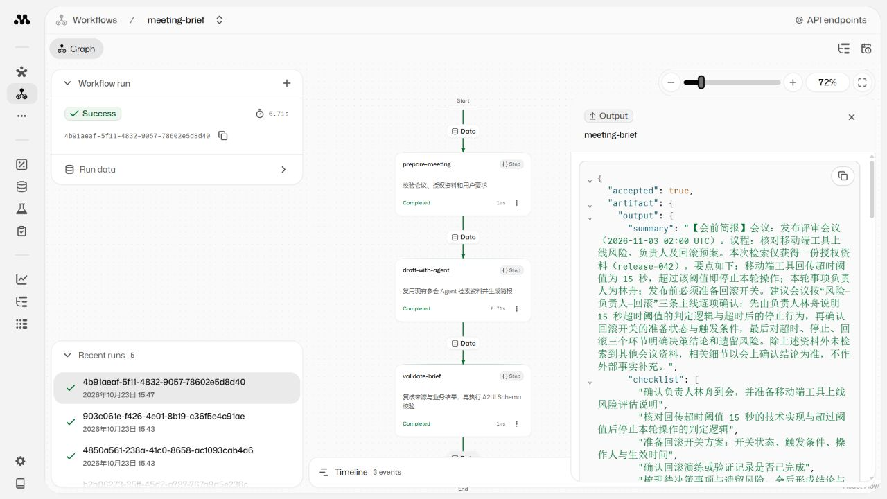
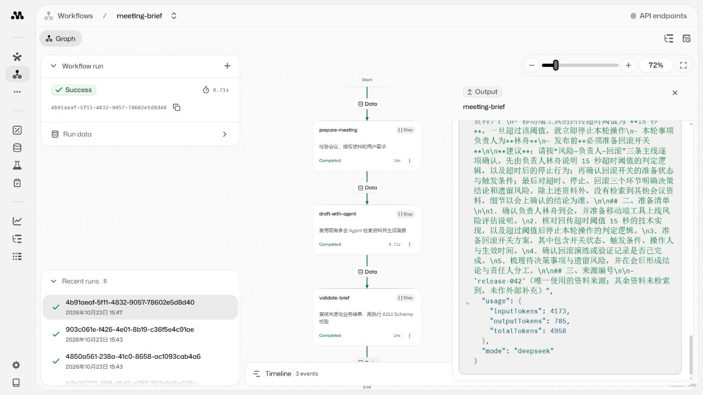
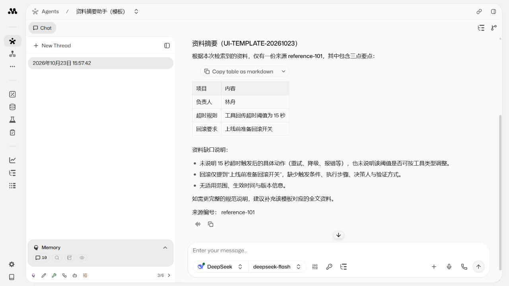

# 开发指南、Agent 模板与原生 Workflow 验收

2026-10-23：功能提交 `83b7761c545e671ea5f55192f3625c38f1abfc30`；最终部署提交 `149789eee57a9751b04244ee77c2dfd98a322383`，release `149789eee57a-20261023T074036`，运行摘要 `619eb3f8b4ebbbcb5d9773c6529ccdaa6071120d1a1fdee172f74cd10d54ff11`。后一个提交只把页面输入示例改成等价 UTC 时间，并增加说明，没有修改运行代码。

## 交付内容

- [扩展开发指南](development.md)：类型选择、原生工厂、Schema、工具与状态、Studio、SDK、持久任务适配、Workflow、验证部署和团队分工。
- [资料摘要 Agent 最小模板](../src/agents/reference.ts)：61 行可运行实现，复用模型、可信资料状态、生命周期和 A2UI 校验，已注册 Studio。
- [三步参会 Workflow](../src/workflows/meeting-brief.ts)：校验输入 → 调用已有参会 Agent → 来源与产物校验；[运行说明](workflows.md)、[输入样例](../workflow-inputs.json)。
- 统一 CLI 新增 workflow-api，all 包含 Workflow 验证；部署增加能力登记检查和 Workflow mock smoke，并兼容旧镜像能力。
- WorkflowLifecycle 贯穿步骤计数、取消信号传播、排空 admission 和实际执行结束后的清理。

## 本地验证

完整 `npm run check` 通过：65 项 TypeScript + 12 项 Python，共 77 项。覆盖原任务回归，以及模板的原生调用、Studio signal、无资料拒绝、伪造来源拒绝；Workflow 的三步结果、流式输出、输入拒绝、重复来源、并发隔离、失败、取消、排空和延迟清理。发布检查额外覆盖旧版本 readiness 及 Workflow 注册缺失。[本地报告](workflow-local-verification.json)。

完整回归针对功能提交 83b7761；随后 UTC 示例补丁用当前 Workflow Schema 验证，并确认与原北京时间 10:00 是同一时刻。最终镜像重新构建并执行部署 smoke、真实 API 和 UI 验收。

最初针对性测试的两个断言不符合已安装 SDK：steps 还含框架 input 记录，Workflow 流式结果通过 stream.result 读取；已按安装版本修正并通过完整回归。预期失败/取消测试会出现 SDK 错误日志，相关测试均检查终态和清理，不作为成功业务运行。

## 最终版本真实验证

| 场景 | 结果 | 证据 |
| --- | --- | --- |
| Workflow API | 三步 success，accepted，来源 release-042，3 条 A2UI 消息；5,532 tokens（Mastra 汇总） | [API 报告](workflow-api-verification.json) |
| 模板 Agent API | 检索、提交、中文回复；来源 reference-101，3 条 A2UI 消息；3,275 tokens（Mastra 汇总） | [API 报告](reference-api-verification.json) |
| Workflow 页面 | 实际填写 JSON 并 Run，三个步骤 Completed，展开 Output 查看 accepted、artifact、text、mode；约 6.71 秒，4,958 tokens | [页面报告](workflow-ui-verification.json) |
| 模板 Agent 页面 | 实际填写 Request context 并 Save，再发送消息；展开 SubmitSummary 核对 accepted / artifact，收到中文表格和来源 | [页面报告](workflow-ui-verification.json) |

模型为服务器配置的 DeepSeek / deepseek-flash。两个页面场景均省略 mode，继承真实模型默认值。模板页面的 token 用量不在 Memory 元数据中，未推算。上述是最终版本的四次真实运行；初版另有两次真实 API 运行通过，在 UTC 示例修正后重新验证最终镜像。

页面运行记录：

- [参会 Workflow](http://127.0.0.1:4411/workflows/meeting-brief/graph/4b91aeaf-5f11-4832-9057-78602e5d8d40)，输入标记 UI-WORKFLOW-20261023。
- [资料摘要助手](http://127.0.0.1:4411/agents/reference-summary/threads/7ec1c104-f06c-443e-bd6c-e7f5b4f21252)，输入标记 UI-TEMPLATE-20261023。

实际页面曾在模型启动前拒绝 `2026-11-03T10:00:00+08:00`，提示 Invalid datetime；改为等价 `2026-11-03T02:00:00Z` 后通过。服务端仍接受原有偏移格式。示例及指南已统一说明 UTC 输入约定，没有放宽日期校验。

## 发布、回退与数据

两次独立构建发布、一次回退至 83b7761、再切回最终 149789e，均通过对应版本的 mock smoke；当前运行最终版本。操作记录与备份路径见 [部署及回退报告](workflow-operations.json)。

开始前的 18 条聊天消息内容摘要全部保留，新增模板的 2 条消息保留；回退前后共 20 条消息及该 Workflow 最终结果的摘要保持一致。原 4391 任务服务未重启或升级，原任务数据摘要不变。最终 Studio 无活跃运行，进程列表只有初始化进程与 Node，无遗留浏览器。[数据及页面报告](workflow-ui-verification.json)。

## 当前边界

该示例使用合成会议和资料，真实调用模型，没有接入真实手机、日历或通知服务。模板 Agent 与 Workflow 可通过原生接口及 Studio 扩展；现有 `/v1/tasks` 仍由 AgentDefinition / TaskRuntime 驱动，Workflow 适配持续任务尚未实现。挂起恢复、崩溃后中途恢复、真实用户鉴权和长期负载均未纳入本次验收。

