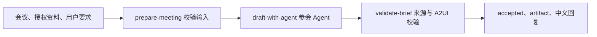

# 原生 Workflow：参会简报示例

Workflow 用明确步骤控制执行顺序、数据交接、分支和并行；Agent 根据目标与当前信息选择工具。一个 Workflow 可以组合普通代码和 Agent。流程顺序可控，但模型生成内容仍可能变化。[官方概览](https://mastra.ai/docs/workflows/overview)、[控制流](https://mastra.ai/docs/workflows/control-flow)。API 以仓库锁定版本的类型为准。

## 当前实现

`meeting-brief` 注册于 `src/mastra/index.ts`：



实现为 `src/workflows/meeting-brief.ts`，复用已有 `createMeetingAgent()` 和 validateBrief。内部使用不带聊天 Memory 的原生 Agent 实例；整个 Workflow 的运行和步骤快照由注册它的 Mastra / 独立 Studio 存储管理。不会启动任务订阅，也不写原任务库。

三个步骤的作用：

| 步骤 | 确定性行为 / 模型行为 |
| --- | --- |
| prepare-meeting | 校验参数、资料 ID 去重，不调用模型 |
| draft-with-agent | 调用参会 Agent；检索授权资料、提交简报，再输出易读回复 |
| validate-brief | 再次检查来源和业务输出，并生成通过 A2UI Schema 校验的 view |

Workflow 返回 `{ accepted, artifact: { output, view }, text, usage, mode }`，不返回原始模型推理。示例没有发信或通知工具。

## Studio 操作

进入 Studio 左侧 Workflows，打开 `meeting-brief`，选择运行入口。在流程 input 中填写 [workflow-inputs.json](../workflow-inputs.json) 的 meeting-brief 值，然后执行。参数属于 **Workflow input**，不放在 Agent 聊天的 Request context 中。

mode 可以省略，继承服务默认；离线测试在 input 中显式添加 `"mode": "mock"`。DeepSeek key 保留在服务器。重点核对三个步骤成功、最终 accepted、artifact、中文 text 和来源编号 release-042。

Studio 当前 Workflow 编辑器会拒绝示例中的 `+08:00` 日期表示，因此页面输入样例统一使用 UTC：`2026-11-03T02:00:00Z` 等于北京时间 10:00。服务端 Schema 和 SDK 仍支持带时区偏移的合法 ISO 日期；这是页面输入的兼容约定。

Workflow 列表与 Agent 列表是不同入口。全局注册 Workflow 后会出现在 Studio 的 Workflows；Agent 列表的 Workflows 列统计该 Agent 显式挂载的工作流，本示例未给现有 Agent 挂载 Workflow。

## SDK 调用

下面是仓库根目录脚本中的最小调用方式：

```ts
import { Mastra } from '@mastra/core/mastra';
import { createMeetingBriefWorkflow } from './src/workflows/meeting-brief.js';

const workflow = createMeetingBriefWorkflow();
new Mastra({ workflows: { 'meeting-brief': workflow }, logger: false });
const run = await workflow.createRun();
const result = await run.start({ inputData: {
  mode: 'mock', instruction: '核对超时和回滚要求',
  meeting: { title: '发布评审', agenda: '回滚准备', startAt: '2026-11-03T10:00:00+08:00' },
  notes: [{ id: 'release-042', text: '负责人林舟；超时15秒停止；准备回滚开关。' }],
} });
if (result.status === 'success') console.log(result.result.text);
else throw new Error(`Workflow ${result.status}`);
```

流式调用是 `run.stream({ inputData })`，消费 fullStream 后读取 `await stream.result`。它与 Agent 的 getFullOutput 不同。取消使用 `await run.cancel()`，步骤将 abortSignal 传入内部 Agent。

原生 HTTP 流程使用 `/api/workflows/meeting-brief/create-run` 创建运行，再向 `/start?runId=...` 提交 inputData；start 返回已启动，不代表执行成功。通过 `/runs/<runId>?fields=result,steps,error` 查询最终状态。完整、有限时的实现见 `scripts/verify-workflow-api.mjs`。

## 生命周期与部署

`WorkflowLifecycle` 在开始时获取一个 Studio 运行票据，并跨步骤保留到终态。部署排空会拒绝新流程，允许已经获准的流程继续；取消时必须等实际步骤清理完毕后才释放票据。

内部 Agent 由 Workflow 管理整轮 admission，不再额外注入 Studio guard，避免部署开始排空后，已获准的流程在进入 Agent 步骤时被当成新运行拒绝。取消信号仍正常传播。重启或恢复进入步骤时会重新检查 admission。

本示例关闭自动重启未完成运行，不声明已验证 suspend / resume 或崩溃后从中间步骤恢复。需要这些行为时，参考官方 [挂起与恢复](https://mastra.ai/docs/workflows/suspend-and-resume)，并补持久化、所有权、回调幂等和部署恢复验收。

现有 `/v1/tasks` 的用户归属、事件合并、基线及版本发布仍由 TaskRuntime 管理；它目前调用 Agent，未增加 Workflow 任务类型。需要 Workflow 驱动持续任务时，在该边界设计适配器，保留现有隔离与发布不变量。

## 验证入口

```powershell
npm.cmd run check -- --suite workflow-api
npm.cmd run check -- --suite workflow-api --mode deepseek
```

默认 mock。远端验证要求运行版本匹配；真实模式每个场景只运行一次，不自动重试。部署 smoke 包含该 Workflow 的 mock 检查。统一 CLI 不代替页面执行。
